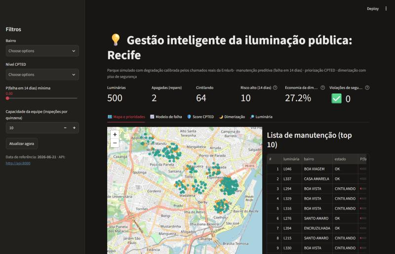
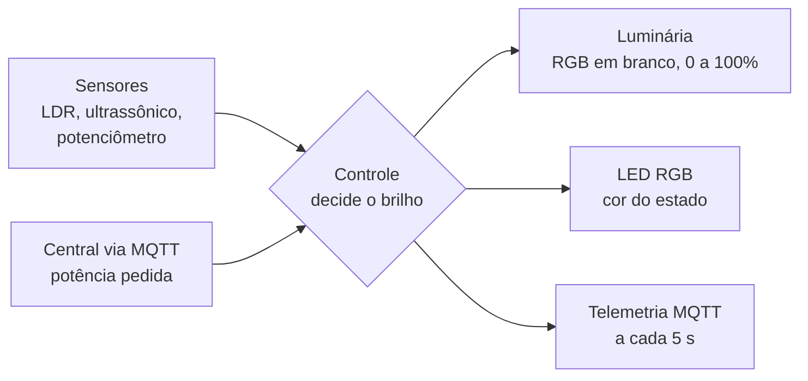
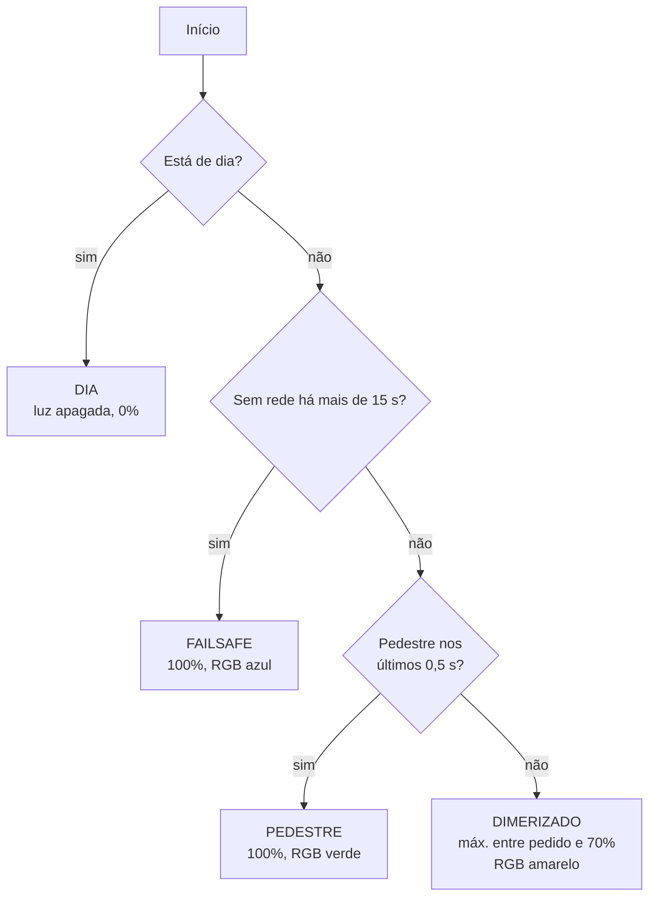

# Poste de Iluminação Pública Inteligente (Grupo 17)

Projeto da disciplina **Sistemas Embarcados** da CESAR School, integrado à proposta de projeto
*Ideação, Proposição e Planejamento* do grupo. Professores: Bella Nunes e Jymmy Barreto.

**Em resumo:**
- **Maquete:** um **ESP32** é um poste numa rua em Y. De dia fica apagado, à noite fica em 70%, vai a
  100% quando passa um pedestre, e manda tudo por **MQTT** para um dashboard em tempo real.
- **Plataforma de gestão** para a prefeitura:
  - 500 luminárias simuladas, com falhas calibradas pelos dados reais da Emlurb;
  - um modelo de **manutenção preditiva** (chance de falha nos próximos 14 dias);
  - **priorização CPTED** dos reparos;
  - **dimerização** com piso de segurança;
  - um **painel com mapa**.
- **Tecnologias:** PostgreSQL, Airflow, MLflow, FastAPI, Streamlit e Docker.



### Como rodar em dois cliques

1. Instale e abra o **Docker Desktop**.
2. Dê dois cliques em **`INICIAR_DEMO.bat`**, na raiz do repositório. Ele pergunta se a maquete está
   ligada (responda **N** para simular tudo), sobe a central e abre:
   - o **painel do gestor** (http://localhost:8501);
   - o **MLflow** (http://localhost:5000);
   - a **API** (http://localhost:8000/docs);
   - o **dashboard da maquete**.
3. Para desligar: **`PARAR_DEMO.bat`**.

Na primeira vez, o Docker leva uns 20 minutos instalando as bibliotecas. Outros jeitos de rodar e o
passo a passo de cada serviço estão em [`applications/README.md`](applications/README.md).

### Documentação

| Documento | Para quê |
|---|---|
| [`docs/ALINHAMENTO_PROPOSTA.md`](docs/ALINHAMENTO_PROPOSTA.md) | Como o repositório atende cada ponto da proposta, com a verificação |
| [`docs/PREMISSAS_SIMULADOR.md`](docs/PREMISSAS_SIMULADOR.md) | Premissas, fontes e calibração do simulador do parque |
| [`docs/CONTEXTO_PARA_IA.md`](docs/CONTEXTO_PARA_IA.md) | Documento técnico completo (também serve de contexto para assistentes de IA) |
| [`docs/O_QUE_FALTA.md`](docs/O_QUE_FALTA.md) | O que ainda falta fazer, com critério de pronto |
| [`docs/AUDITORIA_ML.md`](docs/AUDITORIA_ML.md) | Entregáveis de ML da disciplina e guia para a banca |
| [`docs/testes_wokwi.md`](docs/testes_wokwi.md) | Registro dos testes no simulador Wokwi |
| [`schematics/`](schematics/) | Ligações da maquete e circuito do Wokwi |
| [`applications/ml/notebooks/`](applications/ml/notebooks/) | EDA e modelos (o 03 é o modelo de falha em 14 dias) |

---

## 1. Contextualização

### O problema
Na maior parte de Recife, a iluminação pública funciona de forma "cega": a lâmpada acende
no fim da tarde e fica na mesma potência a noite inteira, haja ou não alguém na rua.
Isso gera três problemas:

- **Desperdício de energia:** ruas vazias de madrugada ficam iluminadas a 100%.
- **Manutenção reativa:** uma lâmpada queimada ou piscando só é consertada quando alguém reclama.
- **Insegurança:** ruas mal iluminadas, ou com lâmpadas falhando, aumentam a sensação de
  insegurança de quem anda a pé.

### A ideia
Transformar cada poste em um **dispositivo conectado** que decide sozinho quanto iluminar e
avisa a central quando algo dá errado. A central (prefeitura ou concessionária) acompanha
tudo num painel e pode ajustar a potência de cada poste remotamente.

### Segurança em primeiro lugar (CPTED)
Economizar energia não pode deixar a rua escura. Seguimos a diretriz **CPTED**
(*Crime Prevention Through Environmental Design*, ou prevenção do crime pelo desenho do
ambiente), que trata a boa iluminação como fator de segurança. Por isso o projeto tem duas
regras que nenhuma economia pode quebrar:

1. **Piso de 70%:** à noite o poste nunca fica abaixo de 70%, mesmo que a central peça menos.
2. **Fail-safe:** se o poste perder contato com a central, ele vai para 100%. Na dúvida, ilumina.

### O MVP
Para a disciplina, um **ESP32** representa um poste, com componentes que simulam o mundo real:

| No poste real | No protótipo |
|---|---|
| Luminária LED | Mini poste de maquete com LED de 3 V, com PWM de 0 a 100% (no Wokwi, um LED RGB aceso em branco) |
| Sensor de luz ambiente | LDR (fotoresistor) |
| Sensor de presença | Sensor ultrassônico HC-SR04 |
| Desgaste ou falha da lâmpada | Potenciômetro (girar = "envelhecer" a lâmpada) |
| Indicador para o técnico | LED RGB de status |
| Rede da cidade | Wi-Fi + MQTT |

A montagem física está concluída: **um ESP32 (o poste `P01`) controlando 3 mini postes de maquete numa
rua em Y**, cada um no seu pino, com dois sensores ultrassônicos (cascata em Y, firmware v3.0). Falta só
decorar a maquete. A demonstração final junta esse poste físico com postes simulados (`P02` em diante)
enviando dados para o mesmo painel.

### A plataforma de gestão (proposta do projeto)

Além da maquete, o projeto entrega a **plataforma de gestão da iluminação** definida na proposta
(*Ideação, Proposição e Planejamento*):

- **Monitoramento remoto:** um parque de **500 luminárias simuladas** em 10 bairros do Recife manda
  telemetria elétrica e térmica (tensão, corrente, temperatura, cintilação, horas, ciclos) por MQTT, e
  ela é gravada em **PostgreSQL**. As falhas vêm de um modelo de degradação de LED (driver, temperatura,
  surtos, cintilação, L70) calibrado com os chamados reais de lâmpada apagada da Emlurb.
- **Manutenção preditiva:** um modelo (Random Forest / XGBoost, Optuna, MLflow) estima a
  **probabilidade de cada luminária falhar nos próximos 14 dias**.
- **Priorização CPTED:** a lista de manutenção combina o risco de falha com um score CPTED (fluxo de
  pedestres, vulnerabilidade noturna e relevância da via, com pesos pelo método AHP).
- **Dimerização adaptativa:** potência conforme o horário e a demanda, nunca abaixo do piso CPTED
  (alta 80-100%, média 70%, baixa 50%) nem do mínimo da ABNT NBR 5101, com teste automático de segurança.
- **Painel do gestor:** mapa em Streamlit com o estado, o risco e a prioridade de cada luminária.

Tudo roda em Docker, orquestrado pelo Airflow. Detalhes em
[`docs/ALINHAMENTO_PROPOSTA.md`](docs/ALINHAMENTO_PROPOSTA.md) e
[`docs/PREMISSAS_SIMULADOR.md`](docs/PREMISSAS_SIMULADOR.md).

---

## 2. Como funciona a lógica

### Visão geral


### As perguntas que o poste faz a cada 20 ms
O controle segue uma ordem de prioridade. A primeira resposta "sim" define o estado:



Por cima de tudo, se o potenciômetro indicar **desgaste acima de 70%**, o estado passa a
ser **FALHA**: o RGB de status fica vermelho e a luminária **pisca de forma irregular**, imitando uma
lâmpada com defeito. A potência calculada é mantida, porque uma lâmpada com defeito não deve
deixar a rua mais escura.

### Os estados

| Estado | Quando | Brilho | RGB |
|---|---|---|---|
| `DIA` | Há luz ambiente suficiente | 0% | Verde |
| `DIMERIZADO` | Noite, rua vazia | Pedido da central, nunca abaixo de 70% | Amarelo |
| `NOITE` | Noite, rua vazia, central pediu 100% | 100% | Verde |
| `PEDESTRE` | Alguém passou a menos de 10 cm nos últimos 0,5 s | 100% | Verde |
| `FAILSAFE` | Noite e mais de 15 s sem comunicação | 100% | Azul |
| `FALHA` | Desgaste da lâmpada acima de 70% | Mantém o calculado, com cintilação | Vermelho |

### As regras, em números

| Parâmetro | Valor | Por quê |
|---|---|---|
| Piso noturno | 70% | Diretriz CPTED: rua nunca fica escura |
| Limite de noite (placa física) | escurece abaixo de 2500, clareia acima de 2700 | Sensível o bastante para a sombra da mão já virar noite na maquete (sala ≈ 3000). A faixa entre os dois valores (histerese) evita que a luz pisque quando a leitura fica perto do limite |
| Distância de presença | menos de 10 cm, em 2 leituras seguidas | Escala da maquete: menor que a distância até o outro lado da rua (no poste real, alguns metros) |
| Tempo de presença | 0,5 s | Na maquete, a luz volta para 70% logo depois que a mão sai (era 2 s; ficava com cara de atraso na demonstração) |
| Correção gama | 4,0 na placa física (2,2 no Wokwi) | O olho não percebe brilho de forma linear: sem a correção, 70% de PWM parece quase 100%. Na maquete, o mini poste (LED de 3 V num pino de 3,3 V) brilha pouco e comprime a diferença, então o gama maior deixa o 70% em ~24% de PWM e o salto para 100% quando o pedestre passa fica evidente. Só muda como o LED mostra o valor; a lógica e a telemetria continuam em 70% |
| Limite de desgaste | 70% | Avisar a manutenção antes da lâmpada queimar |
| Carência do fail-safe | 15 s | Quedas rápidas da rede são ignoradas; quedas longas acionam a segurança |
| Telemetria | a cada 5 s | Painel atualizado sem sobrecarregar a rede |

### A cascata em Y (firmware v3.0)

A maquete tem uma rua em formato de **Y**, com um poste na base e um em cada braço. O sensor **S1**
fica na entrada da rua e o **S2** no braço esquerdo.

| Momento | Base | Esquerdo | Direito |
|---|---|---|---|
| Pedestre passa no **S1** | 100% | **85%** | **85%** (os dois pré-acesos: o caminho ainda não é conhecido) |
| Passa no **S2** em até 4 s (foi para a esquerda) | 70% | **100%** | 70% |
| **Não** passa no S2 em 4 s (foi para a direita) | 70% | 70% | **100%** |
| 2,5 s depois da confirmação | 70% | 70% | 70% |

Se o **modelo de ML** responder (tópico `rota`), só o braço previsto acende, a 100%, antes de o pedestre
chegar. Cada travessia completa vira um registro (tópico `travessia`) com o lado real, que é o dado de
treino do modelo. As regras de segurança valem para cada poste: de dia apagado, piso de 70% à noite e
100% no fail-safe.

### Exemplo de uma noite
1. **18h, anoitece:** o LDR detecta pouca luz e o poste acende a 70% (`DIMERIZADO`).
2. **Um pedestre passa:** o ultrassônico detecta e a luz vai a 100% (`PEDESTRE`).
3. **Meio segundo depois do pedestre sair:** volta a 70%.
4. **A central pede 90%** (por exemplo, para um evento na rua): passa a 90%.
5. **A rede cai por 3 s:** nada muda, porque está dentro da carência.
6. **A rede cai por 20 s:** depois de 15 s, o poste vai a 100% (`FAILSAFE`). Quando a rede volta, ele retoma o normal sozinho.
7. **A lâmpada começa a falhar:** o RGB fica vermelho, a luz cintila e a central vê `"estado":"FALHA"` no painel e manda um técnico.

---

## 3. Arquitetura do firmware

O ESP32 roda **FreeRTOS** com três tarefas independentes que compartilham um estado
protegido por **mutex**:

| Tarefa | Prioridade | Período | Responsabilidade |
|---|---|---|---|
| `sensores` | 2 | 60 ms | Lê LDR, ultrassônico e potenciômetro |
| `controle` | 3 (maior) | 20 ms | Decide o estado e o brilho, aciona os LEDs |
| `comunicacao` | 1 | 20 ms | Wi-Fi, MQTT, telemetria e comandos |

O controle tem a **maior prioridade** porque a luz da rua não pode depender da rede.
Mesmo se a comunicação travar, o poste continua decidindo e iluminando.

### Contrato MQTT

| Tópico | Direção | Conteúdo |
|---|---|---|
| `g17/poste/P01/telemetria` | poste → central | JSON a cada 5 s |
| `g17/poste/P01/comando` | central → poste | `{"potencia": 0-100}` |
| `g17/poste/P01/status` | poste → central | `online` / `offline` (mensagem retida + LWT) |
| `g17/poste/P01/risco` | central (ML) → poste/dashboard | risco previsto para o bairro do poste (retido) |
| `g17/poste/P01/evento` | poste → central (ML) | `{"tipo":"entrada","dist_s1":3.9,...}`: pedestre entrou pelo S1, pede a previsão do caminho |
| `g17/poste/P01/rota` | central (ML) → poste | `{"direcao":"esquerda","confianca":0.82}`: braço previsto pelo modelo |
| `g17/poste/P01/travessia` | poste → central | `{"dist_s1":3.9,"previsto":"...","fonte":"...","real":"direita","acertou":-1,"duracao_ms":4016,...}`: travessia completa, dado de treino do modelo de rota |

Exemplo de telemetria:
```json
{"id":"P01","luz":32,"noite":1,"dist":202,"presenca":0,"desgaste":0.28,
 "pct":70,"estado":"DIMERIZADO","pedido":40,"uptime":15}
```

| Campo | Significado |
|---|---|
| `luz` | Luz ambiente (0 = escuro, 4095 = muito claro) |
| `noite` | 1 se está de noite |
| `dist` | Distância medida pelo ultrassônico, em cm (999 = nada detectado) |
| `presenca` | 1 se houve pedestre nos últimos 0,5 s |
| `desgaste` | Desgaste da lâmpada, de 0.00 a 1.00 |
| `pct` | Brilho atual da luz, em % |
| `estado` | Estado atual (ver tabela de estados) |
| `pedido` | Última potência pedida pela central |
| `uptime` | Segundos desde que o poste ligou |
| `dist_s2`, `presenca_s2` | Distância e presença no S2 (braço esquerdo), desde a v3.0 |
| `pct_base`, `pct_esq`, `pct_dir` | Brilho de cada um dos 3 postes, em % (`pct` = `pct_base`) |
| `rota`, `rota_fonte` | Braço aceso pela cascata (`nenhuma`, `esquerda`, `direita`) e de onde veio (`aguardando`, `modelo`, `confirmada`) |

O **LWT** (*Last Will and Testament*) faz o próprio broker publicar `offline` se o poste
desligar ou perder a conexão sem avisar. Assim a central sabe na hora que um poste caiu.

---

## 4. Hardware

O diagrama de ligações da montagem atual está em [`schematics/`](schematics/README.md).

### Mapa de pinos (ESP32 DevKit)

| GPIO | Componente |
|---|---|
| 18 | Poste da **base** do Y (mini poste LED 3 V: fio vermelho via resistor de 100 Ω, fio branco no GND). No Wokwi: LED RGB com R, G e B juntos |
| 22 | Poste do **braço esquerdo** (mesma ligação, resistor de 100 Ω). No Wokwi: LED branco |
| 23 | Poste do **braço direito** (mesma ligação, resistor de 100 Ω). No Wokwi: LED branco |
| 19 / 21 / 5 | LED RGB **de status** R / G / B (220 / 100 / 100 Ω) |
| 26 / 27 | **S1**, HC-SR04 da entrada da rua: TRIG / ECHO (na montagem, ECHO ligado direto, ver abaixo) |
| 2 / 4 | **S2**, HC-SR04 do braço esquerdo: TRIG / ECHO. Em D25/D32 não respondeu; em D2/D4 funcionou (26/11) |
| 34 | Sensor de luz de 2 pernas em divisor com 10 kΩ: `3V3 → sensor → GPIO34 → 10 kΩ → GND` (no Wokwi: módulo de 4 pinos, pino AO) |
| 35 | Potenciômetro (simula desgaste) |

O **HC-SR04 precisa de 5 V**: alimente-o pelo pino **VIN** (5 V vindos do USB), porque em 3,3 V ele não
responde. Na montagem do grupo, o **ECHO está ligado direto no GPIO27**, por orientação do professor, e
funciona. Como o ECHO devolve 5 V e o ESP32 é de 3,3 V, o recomendado para um poste de verdade é um
**divisor de tensão no ECHO**:

```
ECHO ──── 1 kΩ ────┬──── GPIO27
                   │
                 1 kΩ
                   │
                 1 kΩ
                   │
                  GND
```
O TRIG pode ir direto no GPIO26. Também funciona com 10 kΩ em cima e 2 × 10 kΩ embaixo.

As entradas analógicas usam os pinos **34 e 35 (ADC1)**, porque os pinos do ADC2 não
funcionam enquanto o Wi-Fi está ligado.

---

## 5. Estrutura do repositório

| Pasta | Conteúdo |
|---|---|
| `esp32-esp8266/poste_g17/` | Firmware do poste (`sketch.ino`), circuito do Wokwi (`diagram.json`) e bibliotecas |
| `applications/dashboard/` | Dashboard da maquete em tempo real |
| `applications/dashboard_gestor/` | Painel do gestor (Streamlit + mapa) |
| `applications/simulador/` | Postes virtuais e o parque de luminárias com degradação |
| `applications/ml/` | Modelo de falha em 14 dias, CPTED, dimerização, pipeline, API, DAGs; modelos da maquete (risco por bairro, rota, anomalias) |
| `applications/` | Broker, coletor, ingestor, Docker Compose e testes ([como rodar](applications/README.md)) |
| `schematics/` | Esquemáticos e fotos da montagem |
| `docs/` | Documentação e [registro de testes](docs/testes_wokwi.md) |
| [`MACHINE_LEARNING.md`](MACHINE_LEARNING.md) | Plano da parte de machine learning (dados da Emlurb, modelo de risco e integração por MQTT) |

---

## 6. Como rodar no simulador (Wokwi)
1. Abra o [Wokwi](https://wokwi.com) e crie um projeto **ESP32**.
2. Copie `sketch.ino`, `diagram.json` e `libraries.txt` da pasta `esp32-esp8266/poste_g17/`.
3. Rode a simulação e acompanhe o **Serial Monitor**. O Wi-Fi pode levar até 30 s para conectar.
4. Clique nos componentes para simular: o slider de luz do LDR (anoitecer), a distância do
   ultrassônico (pedestre) e o potenciômetro (desgaste).
5. Para ver a telemetria de fora: abra o [HiveMQ Web Client](https://www.hivemq.com/demos/websocket-client/),
   clique em **Connect** e assine `g17/poste/P01/#`.
6. Para mandar um comando, publique `{"potencia":90}` no tópico `g17/poste/P01/comando`.

O broker `broker.hivemq.com` é público e serve só para testes.

Para gravar na placa física, mude `#define SIMULACAO 1` para `0` e preencha o nome e a senha da sua rede Wi-Fi.
**Não envie a senha real para o repositório.**

---

## 7. Status do projeto
- [x] Lógica de controle (dia/noite, pedestre, falha, piso CPTED)
- [x] FreeRTOS com 3 tarefas e mutex
- [x] Telemetria e comandos via MQTT + LWT
- [x] Fail-safe com carência de 15 s
- [x] Testes no simulador ([registro](docs/testes_wokwi.md))
- [x] Montagem física (1 ESP32 = poste `P01`, cascata em Y com 3 mini postes e 2 ultrassônicos; falta só decorar a maquete)
- [x] Dashboard web recebendo telemetria e enviando comando (testado com a placa real)
- [x] IPv6 no broker local (testado por `::1`; ver [`applications/README.md`](applications/README.md))
- [x] Central: Mosquitto local + coletor em SQLite + alertas (Telegram opcional), em Docker
- [x] Simulador de postes virtuais (`P02`..`P10`)
- [x] Modelo de risco por bairro com MLflow, API, publicação no MQTT e DAG do Airflow
      ([`applications/ml/README.md`](applications/ml/README.md))
- [x] Parque de 500 luminárias simuladas com degradação, calibrado com a Emlurb, gravando em PostgreSQL
- [x] Modelo de falha em 14 dias (RF/XGBoost, Optuna, calibração, PR-AUC, robustez) no MLflow
- [x] Score CPTED (AHP + sensibilidade) e dimerização com piso de segurança (0% de violações)
- [x] Painel do gestor em Streamlit com mapa; DAGs `g17_falha_14d`; testes automáticos
- [x] Ponte Mosquitto local ↔ HiveMQ pronta, para a placa usar a central local sem regravar
- [ ] Testar a ponte e o modelo de rota com a placa no dia (A5/F4/F10)
- [ ] Relatório CSBC

---

## Uso de inteligência artificial

Declaração exigida pelo edital:

- **Ferramenta:** parte do código, dos testes e da documentação deste repositório foi feita com o apoio
  do assistente de programação **Claude Code** (Anthropic).
- **Como identificar:** os commits feitos com esse apoio terminam com a linha
  `Co-Authored-By: Claude ...`, e dá para vê-los no histórico do Git.
- **Uso:** escrever e revisar código (firmware, central, modelos, pipeline, painéis), escrever e rodar
  testes, revisar a documentação e conferir números.
- **Revisão:** as decisões de projeto e os resultados foram conferidos pelo grupo. Isso inclui os testes
  automáticos em `applications/tests/`, os testes no Wokwi (`docs/testes_wokwi.md`) e os testes na placa.
- **Relatório CSBC:** o texto é escrito pelo grupo. A IA foi usada **apenas para revisão de texto**,
  como permite o edital, e isso também está declarado no relatório.
- **Outras ferramentas:** quem usou outra IA no projeto (por exemplo, ChatGPT) deve acrescentar aqui qual
  foi e para quê.

---

## Equipe
Antônio Augusto, Arthur Sales, Bruno Mayer, Felipe Andrade, Henrique Figueredo,
Luiz Claudio Pinheiro e Miguel Becker.

> Vai usar um assistente de IA no projeto? Anexe o arquivo
> [`docs/CONTEXTO_PARA_IA.md`](docs/CONTEXTO_PARA_IA.md) no início da conversa.
> O que ainda falta fazer está em [`docs/O_QUE_FALTA.md`](docs/O_QUE_FALTA.md).
