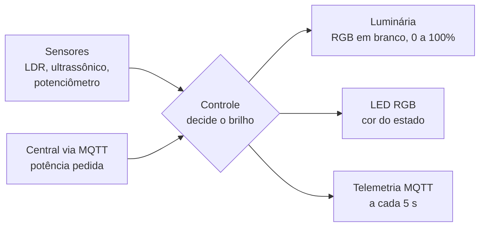
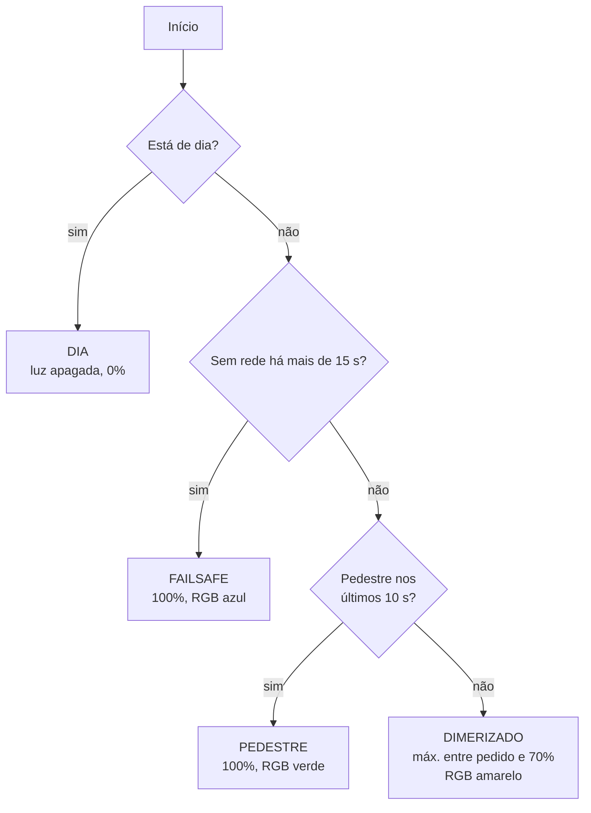

# Poste de Iluminação Pública Inteligente (Grupo 17)

Projeto da disciplina **Sistemas Embarcados** da CESAR School.
Professores: Bella Nunes e Jymmy Barreto.

---

## 1. Contextualização

### O problema
Na maior parte de Recife, a iluminação pública funciona de forma "cega": a lâmpada acende
no fim da tarde e fica na mesma potência a noite inteira, haja ou não alguém na rua.
Isso gera três problemas:

- **Desperdício de energia:** ruas vazias de madrugada ficam iluminadas a 100%.
- **Manutenção reativa:** uma lâmpada queimada ou piscando só é consertada quando alguém reclama.
- **Insegurança:** ruas mal iluminadas, ou com lâmpadas falhando, aumentam a sensação de
  insegurança de quem anda a pé.

### A ideia
Transformar cada poste em um **dispositivo conectado** que decide sozinho quanto iluminar e
avisa a central quando algo dá errado. A central (prefeitura ou concessionária) acompanha
tudo num painel e pode ajustar a potência de cada poste remotamente.

### Segurança em primeiro lugar (CPTED)
Economizar energia não pode deixar a rua escura. Seguimos a diretriz **CPTED**
(*Crime Prevention Through Environmental Design*, ou prevenção do crime pelo desenho do
ambiente), que trata a boa iluminação como fator de segurança. Por isso o projeto tem duas
regras que nenhuma economia pode quebrar:

1. **Piso de 70%:** à noite o poste nunca fica abaixo de 70%, mesmo que a central peça menos.
2. **Fail-safe:** se o poste perder contato com a central, ele vai para 100%. Na dúvida, ilumina.

### O MVP
Para a disciplina, um **ESP32** representa um poste, com componentes que simulam o mundo real:

| No poste real | No protótipo |
|---|---|
| Luminária LED | LED RGB aceso em **branco** (R, G e B juntos), com PWM de 0 a 100% |
| Sensor de luz ambiente | LDR (fotoresistor) |
| Sensor de presença | Sensor ultrassônico HC-SR04 |
| Desgaste ou falha da lâmpada | Potenciômetro (girar = "envelhecer" a lâmpada) |
| Indicador para o técnico | LED RGB de status |
| Rede da cidade | Wi-Fi + MQTT |

A demonstração final terá **1 poste físico + 20 postes simulados** enviando dados para o
mesmo painel.

---

## 2. Como funciona a lógica

### Visão geral


### As perguntas que o poste faz a cada 50 ms
O controle segue uma ordem de prioridade. A primeira resposta "sim" define o estado:



Por cima de tudo, se o potenciômetro indicar **desgaste acima de 70%**, o estado passa a
ser **FALHA**: o RGB de status fica vermelho e a luminária **pisca de forma irregular**, imitando uma
lâmpada com defeito. A potência calculada é mantida, porque uma lâmpada com defeito não deve
deixar a rua mais escura.

### Os estados

| Estado | Quando | Brilho | RGB |
|---|---|---|---|
| `DIA` | Há luz ambiente suficiente | 0% | Verde |
| `DIMERIZADO` | Noite, rua vazia | Pedido da central, nunca abaixo de 70% | Amarelo |
| `NOITE` | Noite, rua vazia, central pediu 100% | 100% | Verde |
| `PEDESTRE` | Alguém passou a menos de 50 cm nos últimos 10 s | 100% | Verde |
| `FAILSAFE` | Noite e mais de 15 s sem comunicação | 100% | Azul |
| `FALHA` | Desgaste da lâmpada acima de 70% | Mantém o calculado, com cintilação | Vermelho |

### As regras, em números

| Parâmetro | Valor | Por quê |
|---|---|---|
| Piso noturno | 70% | Diretriz CPTED: rua nunca fica escura |
| Distância de presença | 50 cm | Escala do protótipo (no poste real, alguns metros) |
| Tempo de presença | 10 s | Luz não "pisca" se a pessoa parar por um instante |
| Limite de desgaste | 70% | Avisar a manutenção antes da lâmpada queimar |
| Carência do fail-safe | 15 s | Quedas rápidas da rede são ignoradas; quedas longas acionam a segurança |
| Telemetria | a cada 5 s | Painel atualizado sem sobrecarregar a rede |

### Exemplo de uma noite
1. **18h, anoitece:** o LDR detecta pouca luz e o poste acende a 70% (`DIMERIZADO`).
2. **Um pedestre passa:** o ultrassônico detecta e a luz vai a 100% (`PEDESTRE`).
3. **10 s depois do pedestre sair:** volta a 70%.
4. **A central pede 90%** (por exemplo, para um evento na rua): passa a 90%.
5. **A rede cai por 3 s:** nada muda, porque está dentro da carência.
6. **A rede cai por 20 s:** depois de 15 s, o poste vai a 100% (`FAILSAFE`). Quando a rede volta, ele retoma o normal sozinho.
7. **A lâmpada começa a falhar:** o RGB fica vermelho, a luz cintila e a central vê `"estado":"FALHA"` no painel e manda um técnico.

---

## 3. Arquitetura do firmware

O ESP32 roda **FreeRTOS** com três tarefas independentes que compartilham um estado
protegido por **mutex**:

| Tarefa | Prioridade | Período | Responsabilidade |
|---|---|---|---|
| `sensores` | 2 | 100 ms | Lê LDR, ultrassônico e potenciômetro |
| `controle` | 3 (maior) | 50 ms | Decide o estado e o brilho, aciona os LEDs |
| `comunicacao` | 1 | 20 ms | Wi-Fi, MQTT, telemetria e comandos |

O controle tem a **maior prioridade** porque a luz da rua não pode depender da rede.
Mesmo se a comunicação travar, o poste continua decidindo e iluminando.

### Contrato MQTT

| Tópico | Direção | Conteúdo |
|---|---|---|
| `g17/poste/P01/telemetria` | poste → central | JSON a cada 5 s |
| `g17/poste/P01/comando` | central → poste | `{"potencia": 0-100}` |
| `g17/poste/P01/status` | poste → central | `online` / `offline` (mensagem retida + LWT) |

Exemplo de telemetria:
```json
{"id":"P01","luz":32,"noite":1,"dist":202,"presenca":0,"desgaste":0.28,
 "pct":70,"estado":"DIMERIZADO","pedido":40,"uptime":15}
```

| Campo | Significado |
|---|---|
| `luz` | Luz ambiente (0 = escuro, 4095 = muito claro) |
| `noite` | 1 se está de noite |
| `dist` | Distância medida pelo ultrassônico, em cm (999 = nada detectado) |
| `presenca` | 1 se houve pedestre nos últimos 10 s |
| `desgaste` | Desgaste da lâmpada, de 0.00 a 1.00 |
| `pct` | Brilho atual da luz, em % |
| `estado` | Estado atual (ver tabela de estados) |
| `pedido` | Última potência pedida pela central |
| `uptime` | Segundos desde que o poste ligou |

O **LWT** (*Last Will and Testament*) faz o próprio broker publicar `offline` se o poste
desligar ou perder a conexão sem avisar. Assim a central sabe na hora que um poste caiu.

---

## 4. Hardware

### Mapa de pinos (ESP32 DevKit)

| GPIO | Componente |
|---|---|
| 18 | Luminária: LED RGB com R (220 Ω), G (100 Ω) e B (100 Ω) ligados juntos neste pino, comum no GND |
| 19 / 21 / 5 | LED RGB **de status** R / G / B (220 / 100 / 100 Ω) |
| 26 / 27 | HC-SR04 TRIG / ECHO (ECHO com divisor de tensão, ver abaixo) |
| 34 | Módulo de luz (LDR) de 4 pinos, saída **AO** (o DO fica solto) |
| 35 | Potenciômetro (simula desgaste) |
| 2 | LED da placa (aceso = conectado à central) |

O **HC-SR04 precisa de 5 V**: alimente-o pelo pino **VIN** (5 V vindos do USB) e use um
**divisor de tensão no ECHO**, porque o sensor devolve 5 V e o ESP32 só aguenta 3,3 V:

```
ECHO ──── 1 kΩ ────┬──── GPIO27
                   │
                 1 kΩ
                   │
                 1 kΩ
                   │
                  GND
```
O TRIG pode ir direto no GPIO26. Também funciona com 10 kΩ em cima e 2 × 10 kΩ embaixo.

As entradas analógicas usam os pinos **34 e 35 (ADC1)**, porque os pinos do ADC2 não
funcionam enquanto o Wi-Fi está ligado.

---

## 5. Estrutura do repositório

| Pasta | Conteúdo |
|---|---|
| `esp32-esp8266/poste_g17/` | Firmware do poste (`sketch.ino`), circuito do Wokwi (`diagram.json`) e bibliotecas |
| `applications/` | Broker, banco de dados, dashboard e simulador *(em desenvolvimento)* |
| `schematics/` | Esquemáticos e fotos da montagem |
| `docs/` | Documentação e [registro de testes](docs/testes_wokwi.md) |

---

## 6. Como rodar no simulador (Wokwi)
1. Abra o [Wokwi](https://wokwi.com) e crie um projeto **ESP32**.
2. Copie `sketch.ino`, `diagram.json` e `libraries.txt` da pasta `esp32-esp8266/poste_g17/`.
3. Rode a simulação e acompanhe o **Serial Monitor**. O Wi-Fi pode levar até 30 s para conectar.
4. Clique nos componentes para simular: o slider de luz do LDR (anoitecer), a distância do
   ultrassônico (pedestre) e o potenciômetro (desgaste).
5. Para ver a telemetria de fora: abra o [HiveMQ Web Client](https://www.hivemq.com/demos/websocket-client/),
   clique em **Connect** e assine `g17/poste/P01/#`.
6. Para mandar um comando, publique `{"potencia":90}` no tópico `g17/poste/P01/comando`.

O broker `broker.hivemq.com` é público e serve só para testes.

Para gravar na placa física, mude `#define SIMULACAO 1` para `0` e preencha o nome e a senha da sua rede Wi-Fi.
**Não envie a senha real para o repositório.**

---

## 7. Status do projeto
- [x] Lógica de controle (dia/noite, pedestre, falha, piso CPTED)
- [x] FreeRTOS com 3 tarefas e mutex
- [x] Telemetria e comandos via MQTT + LWT
- [x] Fail-safe com carência de 15 s
- [x] Testes no simulador ([registro](docs/testes_wokwi.md))
- [ ] Montagem física
- [ ] IPv6
- [ ] Central: Mosquitto + SQLite + dashboard Streamlit
- [ ] Simulador de 20 postes

---

## Equipe
Antônio Augusto, Arthur Sales, Bruno Mayer, Felipe Andrade, Henrique Figueredo,
Luiz Claudio Pinheiro e Miguel Becker.

> Vai usar um assistente de IA no projeto? Anexe o arquivo
> [`docs/CONTEXTO_PARA_IA.md`](docs/CONTEXTO_PARA_IA.md) no início da conversa.
