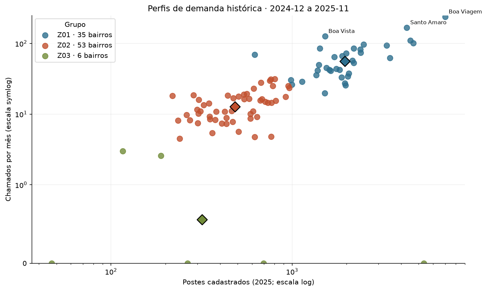

# T19 · Zonas prioritárias por perfis históricos

Implementada em **27/11/2026**, por **Luiz Claudio**. Análise complementar prevista em
`MACHINE_LEARNING.md` §2.2 e `AUDITORIA_ML.md` ML-12.

## Escopo e origem

Agrupamento dos **94 bairros** dos CSVs processados da Emlurb por duas features:
**média mensal de chamados de lâmpada apagada** e **total de postes cadastrados**.
Os chamados observados usam os últimos 12 meses completos disponíveis no painel processado:
**2024-12 a 2025-11**; o cadastro de postes é de **2025**.

Não são usadas as previsões do modelo de bairro nem a coluna de alvo `chamados_mes_seguinte`.
Os dados reais são agregados por bairro; não se exige novo download dos CSVs brutos.
O nome “zona” identifica um perfil de demanda, sem exigir proximidade geográfica.

## Método reproduzível

1. Exigir um registro por bairro/mês em todos os meses da janela e correspondência com o cadastro.
   Rejeitar duplicatas, lacunas, bairros vazios, nulos, negativos, infinitos e contagens fracionárias.
   Lacunas não são convertidas em chamados zero.
2. Aplicar `log1p` e `StandardScaler` às duas features, para reduzir a assimetria e equilibrar unidades.
3. Ajustar K-Means com semente **17** e **20 inicializações** por candidato, comparando **k=2..6**.
   Escolher maior silhouette; em empate, escolher menor k. `--k` permite escolha explícita dentro desse intervalo.
4. Nomear grupos pela média observada de chamados por bairro em ordem decrescente (`Z01`, `Z02`...).
   Os IDs são deste snapshot e podem mudar em novas janelas.
5. Comparar com sementes 27/37/47/57 por Adjusted Rand Index (ARI).
6. Exportar CSV e JSON com versões, parâmetros, candidatos, centros, perfis e SHA-256 das fontes/saída.
   Hashes normalizam CRLF/LF para preservar a compatibilidade entre Windows e Linux.
   A API rejeita fontes alteradas ou CSV/metadados incompatíveis até a regeneração.

Documentação primária: [K-Means](https://scikit-learn.org/stable/modules/generated/sklearn.cluster.KMeans.html)
e [silhouette](https://scikit-learn.org/stable/modules/generated/sklearn.metrics.silhouette_score.html).

## Resultado do snapshot

**k=3**, silhouette **0.533218** e ARI mínimo **0.933491**
nas quatro sementes adicionais. Silhouette de k=2: **0.522640**;
o melhor valor entre os cinco candidatos foi o de k=3.

| Grupo | Bairros | Chamados/mês por bairro | Postes por bairro | Chamados/mês por 1.000 postes |
|---|---:|---:|---:|---:|
| Z01 | 35 | 66.00 | 2207.77 | 29.90 |
| Z02 | 53 | 14.18 | 523.28 | 27.11 |
| Z03 | 6 | 0.93 | 1109.83 | 0.84 |

Médias das duas primeiras medidas são aritméticas entre bairros. A taxa do grupo é ponderada pela
quantidade de postes. A taxa dá contexto e **não** é uma terceira feature do agrupamento.
Centros reconvertidos do K-Means (losangos no gráfico) diferem dessas médias aritméticas.



## Uso e entregáveis

```bash
python applications/ml/src/zonas_prioritarias.py
# Opcionais: --meses 12 --k 3 --saida <diretorio>
python -m pytest applications/tests -q
```

- Módulo: `applications/ml/src/zonas_prioritarias.py`.
- Saídas versionadas: `applications/ml/models/zonas_bairros.csv` e `metadados_zonas.json`.
- Notebook executado: `applications/ml/notebooks/04_zonas_prioritarias.ipynb`.
- API: **GET `/zonas`**, retorna `metadados` e a lista de bairros; independe do banco do parque.
  Retorna 503 com orientação de regeneração quando os artefatos não estão disponíveis ou consistentes.
- Painel do gestor: aba **Zonas**, com gráfico, filtro de grupos, tabela e download do recorte em CSV.
  Os filtros do parque simulado não alteram essa análise global dos 94 bairros.
- A geração é manual e explícita após atualizar os CSVs. Não há novo DAG, serviço de retreino ou
  registro no MLflow: este é um snapshot descritivo versionado, não um modelo preditivo de produção.

## Validação

- **52 testes aprovados**, incluindo 15 novos casos: ordem de entrada/reprodutibilidade, agregação
  temporal sem alvo futuro, dados inválidos, k/perfis degenerados, reconstrução dos 94 bairros,
  integridade/hashes com CRLF/LF, API sem dependência do parque e filtro da aba Zonas.
- Notebook reexecutado em kernel novo, sem erros, com quatro células de código e dois gráficos salvos.
- Fluxo real de validação: painel → API `/zonas` → CSV/JSON versionados → gráfico/tabela/exportação.
- No navegador, selecionar Z01 e exportar gerou um CSV com **35 bairros**, todos de Z01.
  Sem erros de console; página sem transbordamento horizontal em 390 px.
- [Painel desktop](figuras/t19/zonas_desktop.jpg) e [painel móvel](figuras/t19/zonas_mobile.jpg)
  capturados após a revisão. O parque de 500 luminárias visível no cabeçalho é o contexto simulado
  temporário da T8; **os pontos e grupos da aba Zonas vêm dos CSVs reais dos 94 bairros**.

## Limitações e relação com CPTED

Volume de chamados mede notificação e demanda de atendimento, não todas as falhas físicas. Bairros
grandes tendem a gerar mais chamados, e poucos chamados podem refletir subnotificação. Z03 não deve
ser interpretado como “seguro”. O cadastro de 2025 é tratado como estático durante a janela.

A transformação, a janela e a faixa de k influenciam os grupos. Silhouette mede separação na escala
transformada, não acurácia. ARI entre sementes não é validação temporal nem garantia sob novos dados.
Não há rótulo de “zona correta” para validar estes grupos. A utilidade operacional deve ser avaliada
pelo grupo/prefeitura junto com o contexto local.

Esse resultado pode apoiar a discussão visual da demanda, mas **não altera score AHP, ranking CPTED,
modelo de falha, potência ou contrato MQTT**. Também não representa territórios contíguos nem estima
criminalidade. O modelo principal do projeto continua sendo falha por luminária em 14 dias.
