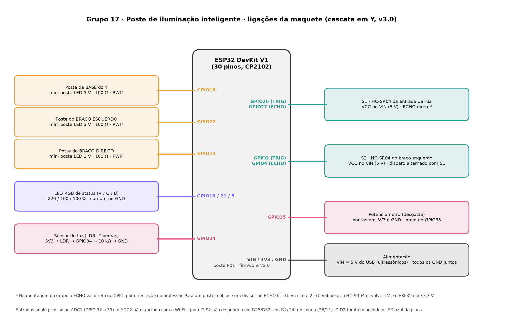
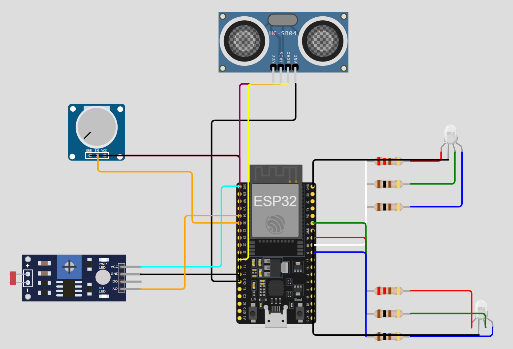

# Esquemáticos (maquete, firmware v3.0, cascata em Y)

A maquete é o poste **`P01`**: um ESP32 DevKit V1 numa rua em formato de **Y**, com um mini poste na
base e um em cada braço (cada um no seu pino PWM), dois sensores ultrassônicos (**S1** na entrada da rua,
**S2** no braço esquerdo), sensor de luz, potenciômetro (desgaste) e LED RGB de status.



*Diagrama de ligações da montagem atual (26/11), feito a partir do mapa de pinos oficial
(`docs/CONTEXTO_PARA_IA.md`, seção 6).*

## Mapa de pinos (placa física: ESP32 DevKit V1, 30 pinos, CP2102)

| GPIO | Componente | Ligação |
|---|---|---|
| **18** | Poste da **base** do Y (PWM) | mini poste LED 3 V: fio vermelho → resistor 100 Ω → GPIO18; fio branco/preto → GND |
| **22** | Poste do **braço esquerdo** (PWM) | mesma ligação, no GPIO22 |
| **23** | Poste do **braço direito** (PWM) | mesma ligação, no GPIO23 |
| **19 / 21 / 5** | LED RGB de status (R / G / B) | via 220 / 100 / 100 Ω; perna comum (a mais comprida) no GND |
| **26 / 27** | **S1** (entrada da rua): TRIG / ECHO | ECHO direto no GPIO (ver observação); VCC no **VIN (5 V)** |
| **2 / 4** | **S2** (braço esquerdo): TRIG / ECHO | ECHO direto; VCC no VIN. Em D25/D32 não respondeu; em D2/D4 funcionou (26/11) |
| **34** | Sensor de luz (LDR de 2 pernas) | divisor: `3V3 → LDR → GPIO34 → 10 kΩ → GND`. Mais luz = número maior |
| **35** | Potenciômetro (simula o desgaste da lâmpada) | pontas em 3V3 e GND, pino do meio no GPIO35 |

**Regras da montagem:**
- Todos os GND ligados juntos (linha azul da protoboard).
- Entradas analógicas só no **ADC1 (GPIO 32 a 39)**, porque o ADC2 não funciona com o Wi-Fi ligado.
- Os HC-SR04 precisam de **5 V** (pino VIN): em 3,3 V eles não respondem.
- Os dois ultrassônicos disparam um de cada vez, para um não ouvir o eco do outro.
- O GPIO2 (TRIG do S2) também acende o LED azul da placa; por isso esse LED não indica mais a conexão.

**Observação sobre o ECHO:** na maquete, o ECHO vai direto no GPIO, por orientação do professor, e
funciona. Num poste real, como o HC-SR04 devolve 5 V e o ESP32 é de 3,3 V, use um divisor de tensão:

```
ECHO ──── 1 kΩ ────┬──── GPIO
                   │
                 1 kΩ
                   │
                 1 kΩ
                   │
                  GND
```

## Simulação no Wokwi

O circuito simulado, já com os 3 postes e os 2 ultrassônicos, está em
[`esp32-esp8266/poste_g17/diagram.json`](../esp32-esp8266/poste_g17/diagram.json). Para abrir: crie
um projeto ESP32 no [Wokwi](https://wokwi.com), cole o `sketch.ino` e o `diagram.json` e adicione a
biblioteca PubSubClient. No Wokwi, a base do Y é um LED RGB com R, G e B juntos, e os braços são LEDs
brancos.

Na placa física (DevKit V1, 30 pinos), siga os **números dos GPIOs**, e não a posição dos fios do
Wokwi (que usa o DevKit C).

### Sensor de luz: simulação × placa física

O Wokwi só oferece o **módulo de 4 pinos** (`wokwi-photoresistor-sensor`). Por dentro, ele é um LDR em
série com um resistor de 10 kΩ, ou seja, o mesmo circuito montado na placa física:

```
3V3 ──── [ sensor de luz, 2 pernas ] ────┬──── [ 10 kΩ ] ──── GND
                                          │
                                       GPIO34
```

No físico, mais luz = número maior (`LDR_INVERTIDO = false`). No módulo do Wokwi, mais luz = número
menor (`LDR_INVERTIDO = true`). O firmware escolhe o sentido certo pela chave `SIMULACAO`.

### Print antigo do Wokwi



*Versão de 19/11 (firmware v2, antes da cascata em Y): um poste só e um ultrassônico. Fica aqui como
histórico; a montagem atual é a do diagrama acima.*

## Fotos da montagem

*A adicionar em `schematics/fotos/`: a maquete montada (visão geral da rua em Y, protoboard com as
ligações e detalhe dos sensores).*
